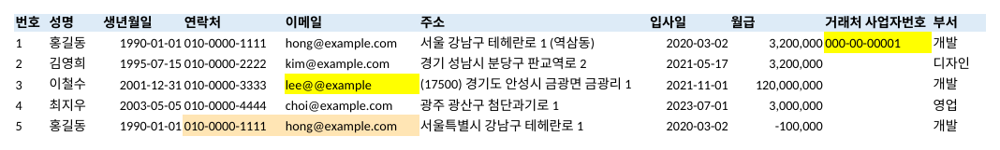

<p align="center"></p>

# 한국식 엑셀 플러그인 (korean-excel)

**Claude가 한국 회사·학교·관공서 엑셀을 한국 방식에 맞게 검사하고 정리하게 해 주는 무료 플러그인입니다.**

> **English**: A free Claude plugin for Korean office spreadsheets (.xlsx / .csv). Validates Korean resident registration and business registration numbers, normalizes Korean date/phone/money formats, masks personal data, splits Korean addresses, computes Korean age, business days with Korean public holidays, Korean money words, merges/splits/dedupes sheets, and saves CP949 CSV for Korean government and bank uploads.

<p align="center"><br><sub>정리한 뒤 검사한 결과 — 틀린 칸은 노란색, 확인할 칸은 살구색 (예시 자료는 가짜입니다)</sub></p>

Claude는 엑셀을 잘 다루지만, "2020. 3. 2."와 "21.11.01"이 같은 날짜 칸에 섞여 있거나, 전화번호 맨 앞 0이 빠져 있거나, "320만원"처럼 글자로 적힌 금액은 사람 손이 많이 갑니다. 이 플러그인을 넣으면 그런 한국식 엑셀 일을 말 한마디로 시킬 수 있습니다.

## 할 수 있는 일

| 이렇게 말하면 | 이렇게 해 줍니다 |
|---|---|
| "이 명단 틀린 데 없나 봐 줘" | 주민번호·사업자번호(검사 숫자)·전화·이메일·날짜를 검사해서 틀린 칸을 노랗게 칠하고 메모를 닮 |
| "날짜랑 전화번호 통일해 줘" | `2020. 3. 2.` `2021년 5월 17일` `21.11.01` `20220104` → 진짜 날짜, `01012345678` `+82 10-…` → `010-1234-5678` |
| "월급 칸 계산되게 해 줘" | `3,200,000원` `320만원` `1억 2천만원` `삼백만원` `(100,000)` → 계산되는 숫자 |
| "개인정보 가려 줘" | 주민번호 뒤 6자리, 전화 가운데, 이메일, 계좌, 이름(홍●동)을 ●로. 제목·작성자 줄, 숨긴 시트, 셀 메모, 글 속에 섞인 것도 |
| "주소 시도별로 나눠 줘" | 시도 / 시군구 / 읍면동·도로명 / 나머지 / 우편번호 |
| "만 나이 계산해 줘" | 주민번호나 생년월일로 생년월일·만 나이·성별 칸 |
| "10월 영업일 며칠이야?" | 주말·공휴일·대체공휴일을 뺀 영업일, N 영업일 뒤 날짜 |
| "한글 금액으로 써 줘" | `일금 일백이십삼만사천오백원정` |
| "이 파일들 하나로 합쳐 줘" | 칸 이름을 맞춰 한 표로, 출처 칸 붙임 ('합계·소계' 줄은 뺌) |
| "부서별로 나눠 줘" | 부서마다 시트 또는 파일 |
| "중복 찾아 줘" | 같은 사람을 색으로 표시하거나 지움 (전화번호 모양이 달라도 같은 번호면 같은 것으로) |
| "은행 업로드용 CSV로 줘" | CP949(EUC-KR) CSV — 한글 안 깨짐 |

원본은 건드리지 않고 `이름_정리.xlsx` 같은 새 파일로 저장합니다. 글자 모양·색·합친 칸·계산식은 그대로 둡니다. 값을 바꾸는 일(정리·가리기·중복 지우기)은 Claude가 먼저 무엇이 몇 곳 바뀌는지 보여 주고 묻습니다.

## 설치

Claude Code에서:

```
/plugin marketplace add rlawhddja1231-hash/korean-excel
/plugin install korean-excel@korean-excel
```

Claude 앱(claude.ai)에서는 `skills/korean-excel` 폴더를 압축해 **설정 → 기능 → 스킬**에 올리면 됩니다.

처음 쓸 때 Claude가 필요한 파이썬 패키지를 알아서 설치합니다:

```
pip install openpyxl holidays
```

## 시험 결과 (2026-10-25)

- 일부러 엉망으로 만든 직원 명단(제목 줄·합친 칸·계산식·여러 날짜 모양·앞 0 빠진 전화·글자 금액)으로 모든 기능 시험
- 3,000줄 무작위 자료로 모든 기능을 돌려 멈추거나 깨지는 곳이 없는지 확인
- 만든 사람과 다른 검사 담당이 일부러 까다로운 파일(제목·작성자 줄, 숨긴 시트, 숫자로 저장된 주민번호, 하이픈 없는 번호, 주문번호 칸, 여러 줄 CSV 칸 등)로 다시 시험 → 찾은 문제 20여 개를 고치고, 가린 파일에 번호·이름이 하나도 남지 않는 것을 확인
- 결과 파일을 LibreOffice로 열어 글자 모양·색·열 너비가 제대로 보이는지 확인

자세한 기록은 [`skills/korean-excel/references/log.md`](skills/korean-excel/references/log.md)에 있습니다.

## 못 하는 것

- 옛날 `.xls` 파일, 암호 걸린 파일 (엑셀에서 `.xlsx`로 다시 저장하면 됩니다)
- 번호가 **실제로 있는지** 조회 (모양과 검사 숫자만 봅니다. 사업자 휴·폐업은 홈택스에서)
- 2020년 10월 이후 새로 받은 주민번호의 검사 숫자 검사 (그래서 "확인 필요"로만 표시)
- 4대 보험·세금 계산 (요율이 해마다 바뀌어서 넣지 않았습니다)
- 그림 속 글자, 시트 이름의 개인정보 가리기, 이름 칸에 없는 별명 찾기

## 직접 써 보기 (명령어)

```
K=skills/korean-excel/scripts/kexcel.py
python3 $K info     명단.xlsx
python3 $K check    명단.xlsx
python3 $K clean    명단.xlsx --dry
python3 $K mask     명단.xlsx --dry
python3 $K addr     명단.xlsx --col 주소
python3 $K age      명단.xlsx --col 생년월일
python3 $K workdays 2026-10-01 2026-10-31
python3 $K workdays 2026-10-25 --add 10
python3 $K holidays 2026
python3 $K money    1234500
python3 $K combine  a.xlsx b.csv --same 성명=이름 --out 합본.xlsx
python3 $K split    명단.xlsx --by 부서
python3 $K dupes    명단.xlsx --cols 성명,연락처
python3 $K tocsv    명단.xlsx --encoding cp949
```

`examples/명단_예시.csv` 에 가짜 명단이 있습니다.

## 고마운 곳

엑셀 읽고 쓰기는 [openpyxl](https://openpyxl.readthedocs.io/) (MIT), 한국 공휴일은 [holidays](https://github.com/vacanza/holidays) (MIT)가 합니다.

"Excel"은 Microsoft의 상표입니다. 이 플러그인은 Microsoft와 관계없는 개인 프로젝트입니다.

## 라이선스

MIT
